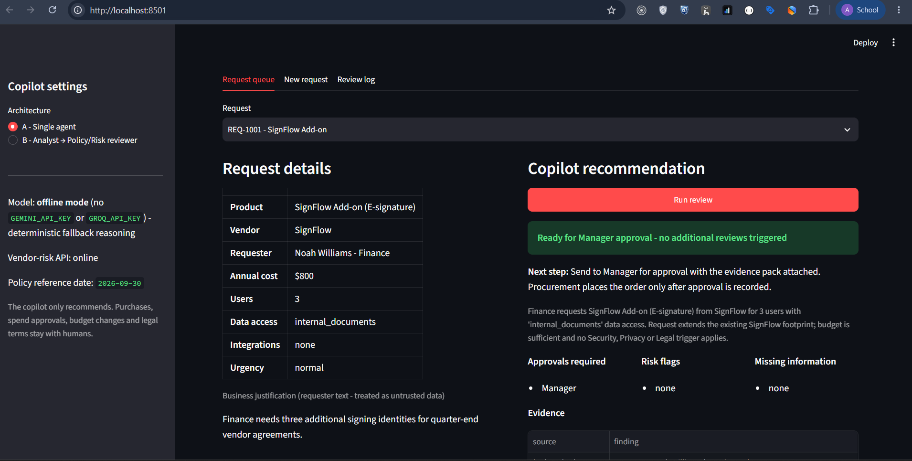
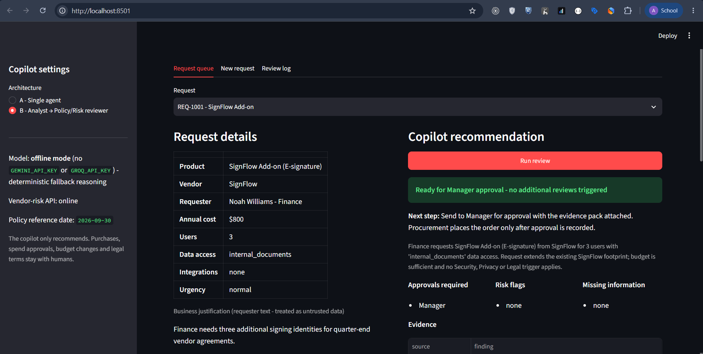
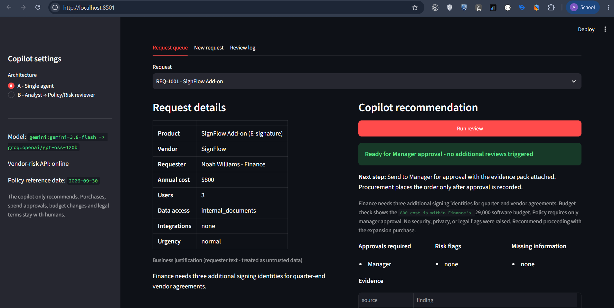
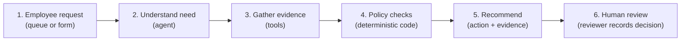

# AI Procurement Request Copilot

Internal tool that reviews software/service purchase requests. It gathers evidence (budget, existing tools, vendor registry, external vendor-risk service), applies the procurement policy with deterministic checks, and recommends a next action. A human still makes the decision.

FDE Assessment 3. All data is synthetic and comes from the starter pack.

| Document | Description |
|---|---|
| [`docs/architecture.md`](docs/architecture.md) | Architecture and workflow diagrams |
| [`docs/decision_memo.md`](docs/decision_memo.md) | Architecture decision memo |
| [`evals/results/summary_offline.md`](evals/results/summary_offline.md) | Offline evaluation baseline; live LLM runs write `summary_live.md` |
| [`evals/results/summary_live.md`](evals/results/summary_live.md) | Live evaluation on Groq `openai/gpt-oss-120b` (same 15 cases, both architectures) |

---

## Screenshots

### 1. Architecture A vs. Architecture B

| Architecture A - Single agent | Architecture B - Staged (Analyst + Reviewer) |
|:---:|:---:|
|  |  |
| One agent, tool-calling loop, code guardrails | Fixed tool plan, two LLM calls, JSON handoff |

---

### 2. Offline vs. Online analysis results

| Offline mode (deterministic fallback) | Online mode (live LLM) |
|:---:|:---:|
|  |  |
| Sidebar shows "offline mode"; overlap is keyword-based | Sidebar shows provider:model; overlap is LLM-judged |

---

### 3. New Request form

| Offline | Online |
|:---:|:---:|
| .png) | .png) |
| Same form and pipeline; overlap decided by heuristic | Same form and pipeline; overlap decided by LLM |

---

### 4. Evidence table and run trace

| Offline evidence + trace | Online evidence + trace |
|:---:|:---:|
| .png) | .png) |
| Mode = `offline`; LLM calls = 0 | Mode = `llm`; provider:model shown in trace |

---

### 5. Human Review form and Review Log

| Human Review form | Review Log |
|:---:|:---:|
| .png) | .png) |
| Reviewer records their own decision; copilot cannot approve | All decisions recorded in the session |

---

## Setup and run

You need Python 3.11 or 3.12. Run every command from the repo root.

```bash
python -m venv .venv
# macOS / Linux
source .venv/bin/activate
# Windows PowerShell
.\.venv\Scripts\Activate.ps1

python -m pip install -r requirements.txt
cp .env.example .env            # Windows: Copy-Item .env.example .env
python verify_setup.py          # should end with PRE-FLIGHT PASSED
```

Start everything with one command:

```bash
python run_local.py
```

This starts the vendor-risk mock API on `http://127.0.0.1:8001` and the UI on `http://127.0.0.1:8501`. Press Ctrl+C to stop both.

### LLM mode vs offline mode

| Mode | How to enable | What changes |
|---|---|---|
| **LLM** | Set `GEMINI_API_KEY=...` in `.env` | Model judges overlap and writes the rationale |
| **Groq fallback** | Add `GROQ_API_KEY` | Used automatically when Gemini hits a quota or outage error |
| **Offline** | No key, or `COPILOT_OFFLINE=1` | Overlap replaced by keyword heuristic; everything else identical |

**LLM mode** uses Gemini's OpenAI-compatible endpoint via the `openai` SDK (default model `gemini-3.8-flash`). Any OpenAI-compatible provider also works with `LLM_BASE_URL`, `LLM_MODEL` and `LLM_API_KEY`.

**Groq fallback** (optional): with `LLM_PROVIDER=auto`, a Gemini 429 or 5xx switches the call to Groq and Gemini enters a cooldown. Request errors (400/401/404) do not fall back, so configuration problems stay visible. `LLM_PROVIDER=gemini` or `groq` pins one provider. Every LLM call records which `provider:model` answered (`telemetry.llm_providers`).

**Offline mode** runs the tools and policy engine exactly the same way. Only the model's judgement (overlap assessment and rationale text) is replaced by a keyword heuristic. Offline mode makes the app, tests and evals runnable anywhere and reproducible.

The UI sidebar shows which mode is active.

Free-tier quotas are small on both providers. A full `compare.py` run makes about 60-75 model requests on Gemini (more on Groq, see below), so it usually needs billing or a run spread over time. Transient errors (500/502/503/504, timeouts) are retried twice with a short backoff; quota errors (429) are never retried.

### Tests and evaluation

```bash
python -m pytest                                        # 138 tests: policy rules, tools, agents, LLM client, provider fallback, live-eval resume, guardrails
python evals/run_public_evals.py --architecture single  # starter harness, 6 public cases
python evals/run_public_evals.py --architecture staged
python evals/compare.py                                 # both architectures, 15 cases -> evals/results/
```

Before spending quota on a full LLM run, smoke-test a few cases. Nothing is written in this mode:

```bash
python evals/compare.py --arch staged --cases PUB-01
python evals/compare.py --arch single --cases PUB-01
python evals/compare.py --cases SYN-03,EXT-03
```

In LLM mode the run is **pinned to one provider** (the primary one, or `--provider gemini|groq`), so both architectures are compared on the same model. It stops at the first case that falls back to the offline heuristics, or that was answered by a different provider, and prints why. Written results are therefore always a single-model LLM evaluation, and the summary names the `provider:model`. A 429 with a short Retry-After (per-minute limit) is waited out up to `--rate-limit-wait` seconds (default 65); longer limits abort the run. `--delay N` pauses between cases and `--rpm N` spaces individual model calls evenly (N calls per minute).

Result files are kept apart so a live run never replaces the offline baseline:

| File | Written by |
|---|---|
| `summary_offline.md`, `comparison_offline.csv` | full offline run (no key or `COPILOT_OFFLINE=1`) |
| `summary_live.md`, `comparison_live.csv` | full LLM run that completed with every case in `llm` mode on one provider |
| `live_progress.csv` | every completed live case, written as it finishes |
| `live_progress_previous.csv` | progress from an earlier run, moved aside when a fresh (non-`--resume`) live run starts |
| `summary_pre_online.md`, `comparison_pre_online.csv`, `summary.md`, `comparison.csv` | earlier offline snapshots, kept for reference |

If a live run stops (quota, outage, model error), the cases it finished stay in `live_progress.csv`. Re-run with the same `--provider` and `--resume` to continue; resume refuses rows from a different `provider:model`.

Rate limits to plan for (check your own account, they change):

- **Gemini free tier** is limited per model per project, per minute and per day. The daily request cap is the usual blocker (one project here hit 20 requests/day). A 429 that names a per-day quota is not waited out; the provider is put on a 1-hour cooldown. Per-minute 429s carry a retry delay in the response body, which is honoured up to `--rate-limit-wait`.
- **Groq** documents 30 RPM, 1K RPD, 8K TPM and 200K TPD for `gpt-oss-120b` on its base plan. Each Architecture A call is about 2K input tokens and gpt-oss makes one tool call per turn, so use `--rpm 3` on Groq to stay under 8K tokens/minute. A full A+B run is roughly 300K tokens, so it spans more than one day on those limits; `--resume` makes that possible without losing finished cases.

The eval scripts start the mock API themselves if it isn't already running.

---

## Product workflow



The UI (Streamlit) has three tabs:

| Tab | Purpose |
|---|---|
| **Request queue** | Pick a request and see its details. The justification is shown as untrusted text. Run the review with architecture A or B. |
| **New request** | A form for submitting an ad-hoc request. Goes through the same pipeline. |
| **Review log** | The decisions human reviewers recorded in this session. |

Each result shows:

- the recommendation, colour-coded by action
- the next step and a short rationale
- approvals required, risk flags and missing information
- an evidence table where every row cites its tool and record (e.g. `software_catalog.csv:SW003`, `Policy §5`)
- a run trace with LLM/tool call counts
- a human review form

The copilot cannot approve anything. Only the human decision is recorded.

---

## Output

`handle_request(request_id, architecture)` in `src/solution.py` returns a `ProcurementDecision`, which carries:

| Field | Notes |
|---|---|
| `recommendation` | Human-readable summary |
| `evidence` | List of sourced evidence items |
| `required_approvals` | From policy engine only |
| `missing_information` | From policy engine only |
| `risk_flags` | From policy engine only |
| `next_step` | Machine-readable action category |
| `human_review_required` | Always `true` |
| `telemetry` | LLM/tool counts, mode, providers |
| `action` | (added) machine-readable next-action category |
| `rationale` | (added) short explanation |

The next-action categories are `request_clarification`, `use_existing_tool`, `verify_vendor_evidence`, `route_for_review` and `standard_approval`.

---

## Architecture

**Design split:**

| Layer | Responsibility |
|---|---|
| **AI** | Understands the need, decides whether an existing tool already covers it, writes the explanation |
| **Code** | Handles thresholds, budget, Security/Privacy/Legal triggers, review expiry, conflicts, injection scanning and tool failures |
| **Human** | Approves, makes exceptions and purchases |

**A - Single agent** (`src/single_agent.py`): one Gemini agent with tool calling. It decides which tools to call and returns a JSON judgement. A code guard then runs any tool the agent skipped, so the policy engine always sees full evidence.

**B - Staged** (`src/staged_agents.py`): code gathers evidence in a fixed order. A **Procurement Analyst** (LLM call 1) assesses the need and the overlap. A **Policy/Risk Reviewer** (LLM call 2) checks that against the policy-engine output. The handoff between them is JSON.

Both architectures end in `src/decision.py`, which builds the decision. The model's text is filtered there: embedded instructions and claims like "already approved" are dropped. Approvals, flags and missing information come only from the policy engine.

### Tools

| Tool | Kind | Purpose |
|---|---|---|
| `lookup_budget` | deterministic | requester, department, available budget vs. cost |
| `search_catalog` | deterministic | same-category approved tools, scope coverage, same-vendor products, purchase history |
| `get_vendor_record` | deterministic | internal registry: procurement, security, legal-terms status |
| `check_vendor_risk` | external API | mock vendor-risk service; 404/503/unreachable recorded, never treated as a pass |
| `run_policy_checks` | deterministic | policy §1-§10: missing fields, approval tiers, triggers, 365-day expiry, conflicts, injection scan |

### Code layout

```text
src/
  policy.py          deterministic policy engine (reference date read from the policy file)
  tools.py           the five tools + ToolBox (caching, telemetry, evidence)
  decision.py        next-action selection, guardrails, ProcurementDecision assembly
  single_agent.py    Architecture A
  staged_agents.py   Architecture B
  llm.py, prompts.py Gemini client and prompts
  solution.py        handle_request / analyze_request adapter
  mock_server.py     starts the mock API for evals/tests
app.py               Streamlit UI
evals/compare.py     A vs B comparison on 15 cases
evals/expected_outcomes.json   expected action / approvals / flags per case
tests/               policy, agent (with scripted fake LLM), data and mock API tests
```

---

## Assumptions

The full list is in [`docs/architecture.md`](docs/architecture.md#assumptions). The main ones:

- Date checks use the policy reference date **2026-09-30**, parsed from `data/procurement_policy.md`. A review exactly 365 days old still counts as current.
- `requested_integrations: []` means none and is complete. `null` means missing. A `data_access_level` of `unknown` means missing.
- A justification that is mostly injected instructions counts as a missing business purpose.
- If the vendor-risk API is unavailable, the vendor is never treated as approved. The request gets Security review, Privacy as a precaution for sensitive data, and the `verify_vendor_evidence` action.
- Cross-region storage of sensitive data triggers both Privacy and Legal.
- A department with no budget row is routed to Finance (`budget_unverified`).
- Overlap is matched on catalog category. A company-wide or same-department tool with no stated gap leads to `use_existing_tool`. A stated gap, or a limited-use approval that doesn't cover the data class, leads to Procurement validation.

---

## Evaluation results

Both architectures were run on the same set: the 6 public cases, the other 4 dataset requests, and 5 synthetic hidden-style requests. The synthetic ones are an unknown vendor, a department with no budget, injection in a clean request, an unknown requester, and exactly $25,000. Each case is scored against expected action, exact approvals, required and forbidden flags, grounding (every evidence row comes from a tool that ran and cites an existing record) and escalation. The run is repeated with the vendor API forced down.

These results are from offline mode (recorded without an API key):

| Metric | Single agent (A) | Staged / 2-agent (B) |
|---|---:|---:|
| Public cases passing minimum checks | 6/6 | 6/6 |
| Correct next action | 15/15 | 15/15 |
| Evidence grounded in tool results | 15/15 | 15/15 |
| Policy / deterministic rules followed | 15/15 | 15/15 |
| Human escalation correct | 15/15 | 15/15 |
| Vendor API down: safe degradation | 15/15 | 15/15 |
| Avg latency (ms, offline) | ~18 | ~17 |
| Avg LLM calls | 0 | 0 |
| Avg tool calls | 5 | 5 |

Per-case details are in `evals/results/summary_offline.md` and `evals/results/comparison_offline.csv`. The starter harness output is in `evals/results_single.csv` and `evals/results_staged.csv`.

With a key set, `python evals/compare.py` runs everything in LLM mode and writes `summary_live.md` and `comparison_live.csv` with measured latency and LLM call counts. The offline baseline is not touched.

Live results, pinned to Groq `openai/gpt-oss-120b` (all 30 rows in `llm` mode, one run per case):

| Metric | Single agent (A) | Staged / 2-agent (B) |
|---|---:|---:|
| Public cases passing minimum checks | 6/6 | 6/6 |
| Correct next action | 13/15 | 14/15 |
| Evidence grounded in tool results | 15/15 | 15/15 |
| Policy / deterministic rules followed | 14/15 | 15/15 |
| Human escalation correct | 14/15 | 15/15 |
| Vendor API down: safe degradation | 15/15 | 15/15 |
| Avg / p95 latency (s) | 37.4 / 55.4 | 23.3 / 31.8 |
| Avg LLM calls | 4.87 | 2.00 |
| Avg tool calls | 5 | 5 |

A missed EXT-03: it sent TaskFlow Pro to standard approval instead of redirecting to the existing TaskFlow licence, and dropped the overlap flag. Both architectures missed SYN-01, holding an unknown vendor that duplicates MetricLoop for vendor verification instead of redirecting to the existing tool. That is a safe outcome, but it is the wrong next action.

---

## Architecture comparison and ship decision

Offline, the two architectures are equivalent on every quality metric, because the policy engine owns approvals, flags and escalation and the overlap judgement is a heuristic. The live run is what separates them. B was at least as good on every quality metric (14/15 vs 13/15 correct actions, 15/15 vs 14/15 on policy and escalation). It used 2.00 LLM calls per request against A's 4.87, because gpt-oss makes one tool call per turn. It was also faster: 23.3 s vs 37.4 s on average, 31.8 s vs 55.4 s at p95. B's extra cost is a second prompt, a handoff format and an extra failure path.

**Decision: ship B (staged analyst -> reviewer + deterministic policy engine).** It matched or beat A on quality and was cheaper and faster on the same test set. The accuracy gap is one case on one model and one run, so the cost and predictability advantage carries most of the weight. The full reasoning is in [`docs/decision_memo.md`](docs/decision_memo.md).

---

## Known limitations

- The live evaluation is a single run (`--repeats 1`) on one model (Groq `openai/gpt-oss-120b`) over 15 cases; Gemini has not been evaluated live. The overlap judgement has not been measured against human-labelled cases.
- The offline overlap heuristic is keyword-based. For example, it treats "advanced" or "additional" in the justification as an expansion.
- Prompt-injection detection is regex-based and will miss paraphrased attacks. The impact is limited because model output cannot change approvals or flags.
- Sensitivity rules use keywords on `data_access_level` and integration names.
- The human review log only lasts for the session: no persistence or authentication.
- The policy engine encodes this policy version (2026.09) in code. A policy change means a code change, with tests.
- Provider fallback is a product availability feature. Gemini and Groq are different models, so their results are never mixed in one evaluation; results from a Groq-pinned run describe the Groq model, not Gemini.
- Groq's gpt-oss models do not make parallel tool calls, so Architecture A uses about one LLM call per tool (up to 6 per request) on Groq. With Groq's published Developer-plan limits for gpt-oss (8K tokens/minute, 200K tokens/day) a full A+B run needs pacing and may not fit in one day. Check your account's limits.
- Overlap labels are checked against the catalog in code. A request that adds capacity to the same vendor's approved product in the same category (more seats or users, an add-on, an expansion; e.g. PUB-01, SignFlow) is classified as `expansion` even if the model says `none`, `overlap_review` or `existing_tool_sufficient`, unless the existing approval is limited-use and the data is sensitive. Tier words alone ("upgrade", "advanced") do not overrule the model, because a higher tier may well be covered by the existing licence. A model `none` while related products exist, or `expansion` of a different vendor's product, is re-derived by the deterministic check, so competing tools (PUB-02) keep their overlap flag. A same-vendor `expansion` from the model is accepted as-is, which is how Architecture A lost the EXT-03 overlap flag in the live run. When `overlap_review` is set, the recommendation and next step ask Procurement to confirm the stated gap first. These signals are keyword-based.
- A vendor security review dated after the policy reference date is treated as invalid, not current: it is flagged `vendor_review_date_invalid`, requires Security and routes the request to manual verification.
- The prompt-injection scan covers string items inside list fields (e.g. `requested_integrations`) as well as top-level text. Costs and user counts must be real numbers: booleans, NaN, negatives and strings count as missing, and user counts must be whole numbers (3 or 3.0).
- One full live comparison has completed, on Groq only. The `json` pseudo-tool workaround is exercised by that run, but it is not tested separately against live responses.
- Running `compare.py --resume` when no `live_progress.csv` exists writes progress rows without a CSV header, so a later resume would misread the file. The final `comparison_live.csv` is not affected.

---

## Changes to the starter pack

- `run_local.py`:
  - Streamlit now starts headless, so the first run no longer hangs on the email prompt.
  - An already running mock API is reused instead of crashing on the port conflict.
- `evals/run_public_evals.py` starts the mock API if needed. Before this change, every case failed as "vendor-risk unavailable" unless the API was started by hand.
- CSV loaders use `keep_default_na=False`, so blank dates and IDs are empty strings instead of `NaN` floats.
- Added `pytest.ini` (`pythonpath = .`) so `tests/test_mock_api.py` can import `mock_api` under pytest.
- Added `openai` and `pytest` to `requirements.txt`.
- Added an offline `handle_request` smoke test to `verify_setup.py`.
- Evaluation CSVs are no longer git-ignored, so the results are part of the submission.

---

## Gemini 3 compatibility

- Architecture A sends the assistant's tool-call message back unchanged, so Gemini's thought signatures (`tool_calls[].extra_content`) survive into the next turn. Gemini 3 models need them for multi-turn tool calling.
- The tools take no arguments, so their schemas omit `parameters` instead of sending an empty object schema.
- When a run falls back, the model error is recorded in `telemetry.llm_error`.
- gpt-oss models on Groq sometimes reply by calling an undeclared `json` tool, which Groq rejects with HTTP 400. When tools are sent to Groq, a `json` pseudo-tool is declared and its arguments are turned back into the plain reply; it is never executed and never shown to the agent loop.
- Requests sent to Groq contain only standard OpenAI message fields; Gemini-specific fields such as `extra_content` are stripped if a conversation switches provider mid-run.
